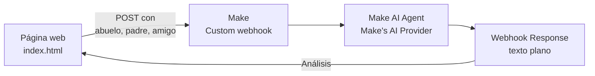

# Estilos de vida entre generaciones

Página web conectada a **Make** y a una **IA** que compara los hábitos de consumo de tres generaciones (abuelo/a, padre/madre y amigo/a) y propone conclusiones sobre su sustentabilidad.

-1f4d3a)


**Ver la página en línea:** https://teatlon-cyber.github.io/PRACTICAS/

[](https://youtube.com/shorts/2-8tSsDLhow?feature=share)

<!-- Cuando tengas una captura general de la página, pega aquí:

-->

---

## Datos de la práctica

| Campo | Detalle |
|---|---|
| Asignatura | Desarrollo Sustentable (ACD-0908) |
| Carrera | Ingeniería en Sistemas Computacionales |
| Unidad | 3. Escenario socio-cultural |
| Tema | 3.4 Estilos de vida, consumo y estrategias de sustentabilidad |
| Práctica | 3.4-P8 Página web "Estilos de vida entre generaciones" |
| Herramientas | Make (Webhooks, Make AI Agent, Webhook Response), IA generativa, GitHub Pages |
| Equipo | _Pendiente: nombre o número de equipo e integrantes_ |

## Objetivo

Distinguir los estilos de vida y de consumo de tres generaciones del entorno, construir sin programar una página web conectada a Make e IA para comparar sus respuestas, y formular conclusiones propias sobre la sustentabilidad de esos hábitos.

## Contexto

La forma en que una familia se alimenta, se viste, se transporta o maneja su basura ha cambiado mucho en tres generaciones. Algunos hábitos de los abuelos eran más sustentables por necesidad (reparar, reutilizar, comprar a granel) y algunos de hoy son mejores por información y tecnología (reciclaje, energías limpias). Comparar esos estilos de vida ayuda a entender cómo la sociedad y el mercado moldean el consumo.

El abuelo/a y el padre/madre responden pensando en cuando tenían entre 18 y 25 años. El amigo/a responde sobre el presente. Solo se registra la edad, sin nombres ni otros datos personales.

## ¿Cómo funciona?



1. La persona llena el formulario con la edad y las respuestas a 8 preguntas por generación.
2. Al pulsar **Comparar respuestas**, la página valida que no falte ningún campo y envía tres textos (`abuelo`, `padre` y `amigo`) al webhook de Make con `fetch` y `URLSearchParams`.
3. El **Make AI Agent** compara las respuestas y genera el análisis.
4. El **Webhook Response** devuelve el análisis como texto plano y la página lo muestra debajo del botón.

### Las 8 preguntas

1. ¿Cómo se conseguía la comida en casa: mercado, tienda, súper o cultivo propio?
2. ¿Qué se hacía con la ropa o los zapatos viejos o rotos?
3. ¿Qué aparatos electrónicos tenías y cada cuánto los cambiabas?
4. ¿Cómo te transportabas a la escuela o al trabajo?
5. ¿Qué se hacía con la basura? ¿Se separaba o se reutilizaba algo?
6. ¿Usabas bolsas, botellas o envases desechables?
7. ¿Cómo se usaba y se cuidaba el agua en casa?
8. ¿Qué consideras necesario para vivir bien?

### Formato de los datos enviados

```text
Edad: [edad]
1. [pregunta]: [respuesta]
...
8. [pregunta]: [respuesta]
```

## Configuración en Make

Escenario: `Generaciones_Equipo#`, programado en **Immediately as data arrives**.

| # | Módulo | Configuración |
|---|---|---|
| 1 | Webhooks → Custom webhook | Recibe los campos `abuelo`, `padre` y `amigo` |
| 2 | Make AI Agent | Conexión Make's AI Provider; el Input mapea `{{1.abuelo}}`, `{{1.padre}}` y `{{1.amigo}}`; las Instructions piden un análisis en texto plano con comparación por tema, análisis y conclusiones |
| 3 | Webhooks → Webhook Response | Status `200`, Body con la respuesta del agente, y los headers `Content-Type: text/plain; charset=utf-8` y `Access-Control-Allow-Origin: *` |


_Escenario `Generaciones_Equipo#` activo en Make: Custom webhook → Make AI Agent → Webhook response._

## Documentos

Las respuestas de las tres generaciones que se capturaron en la página están en estos archivos:

- [Entrevistas (PDF)](documentos/Entrevistas.pdf)
- [Entrevistas de prueba (PDF)](documentos/Entrevistas_de_prueba.pdf)

## Resultados

Prueba realizada con las respuestas de ejemplo de los documentos anteriores. El análisis que devolvió la IA fue el siguiente.

### Comparación por tema

| Tema | Abuelo/a | Padre/Madre | Amigo/a |
|---|---|---|---|
| Comida | Mercado y tienda, con huerto y huevos | Mercado y supermercado, sin cultivo propio | Supermercado y apps de entrega |
| Ropa | Remendaba, heredaba y ponía suela nueva a los zapatos | Regalaba o tiraba la ropa y cambiaba los zapatos | Dona o vende en apps de segunda mano, o tira si está muy dañada |
| Electrónicos | Pocos aparatos, cambiados solo al descomponerse | TV, estéreo, computadora y celular; cambio cada 4–5 años | Celular, laptop, audífonos y tablet; celular cada 2–3 años |
| Transporte | Caminaba, camión o bicicleta | Camión y luego carro | Camión, plataformas de transporte y a veces carro |
| Basura | Casi no generaba; reutilizaba frascos, latas y costales; se quemaba o enterraba | Todo en una bolsa; a veces vendía latas o cartón | Separa algo de cartón y botellas; casi todo se mezcla |
| Desechables | No usaba; devolvía botellas de vidrio | Bolsas y botellas de plástico, con vidrio retornable aún presente | Usa desechables; tiene botella reutilizable pero a veces la olvida |
| Agua | La acarreaba y guardaba; la cuidaba mucho | Agua de la llave con tinaco; la cuidaba ante la escasez | Agua de la llave; busca no desperdiciarla, sin ser una preocupación constante |
| Vivir bien | Comer, techo, trabajo, salud y familia | Buen trabajo, ingresos estables, salud, casa propia y estudio para los hijos | Estar sano, ingresos, internet, tiempo libre, estudiar y viajar |

### Análisis y conclusiones de la IA

- Antes había mayor énfasis en reutilizar recursos y valorar la comida local. Hoy predominan el consumo y el desecho rápido, con más dependencia de la tecnología y de los servicios de entrega.
- Se observa una transición de la reparación y el autoconsumo hacia un consumo externalizado. La urbanización, los electrodomésticos y los plásticos cambiaron la relación con la basura y el agua.
- Conclusiones: reforzar la reparación y reutilización de ropa y objetos, promover un consumo sostenible con menos envases desechables, y cultivar un huerto o un cultivo propio en casa.

<!-- Cuando tengas la captura del resultado de la IA en la página, pega aquí:

-->

### Créditos consumidos en Make

| Dato | Valor |
|---|---|
| Créditos del análisis | 3,85 |
| Operaciones | 3 (una por módulo) |
| Duración de la ejecución | 10 segundos |
| Transferencia de datos | 17,2 KB |
| Resultado | Éxito (30 de octubre de 2026) |


_Historial del escenario: el análisis consumió 3,85 créditos en una ejecución exitosa._

## Reflexión

El informe con las respuestas a las cinco preguntas de reflexión (generación más sustentable, cambios en la sociedad, revisión del análisis de la IA, relación con la Carta de la Tierra y la Agenda 21, y hábitos a retomar) está en este repositorio:

- _Pendiente: agregar el enlace al informe cuando se suba_

En resumen:

- La generación del abuelo/a fue la más sustentable, más por **necesidad** que por convicción.
- La urbanización, la tecnología, el ingreso y los plásticos explican los cambios de consumo.
- La IA acertó en la comparación por tema, pero invirtió un dato (las bolsas de tela del abuelo) y dejó fuera que quemar la basura no era sustentable.
- Los hábitos que se retomarían son el cultivo propio, la reparación y la reutilización.

## Estructura del repositorio

```text
PRACTICAS/
├── index.html                      # Página web (HTML, CSS y JavaScript en un solo archivo)
├── README.md                       # Este documento
├── documentos/
│   ├── Entrevistas.pdf             # Respuestas de las tres generaciones
│   └── Entrevistas_de_prueba.pdf   # Versión de prueba de las entrevistas
└── imagenes/
    ├── escenario-make.png          # Escenario en Make
    └── historial-make.png          # Historial y créditos consumidos
```

## Cómo usarla

1. Abre la página: https://teatlon-cyber.github.io/PRACTICAS/
2. Llena la edad y las 8 respuestas de cada generación. Todos los campos son obligatorios.
3. Pulsa **Comparar respuestas** y espera de 10 a 30 segundos.
4. Lee el análisis que aparece debajo del botón.

## Tecnologías

- HTML, CSS y JavaScript, sin librerías externas
- Make (Webhooks y Make AI Agent)
- GitHub Pages

---

_Última actualización: 30 de octubre de 2026_
